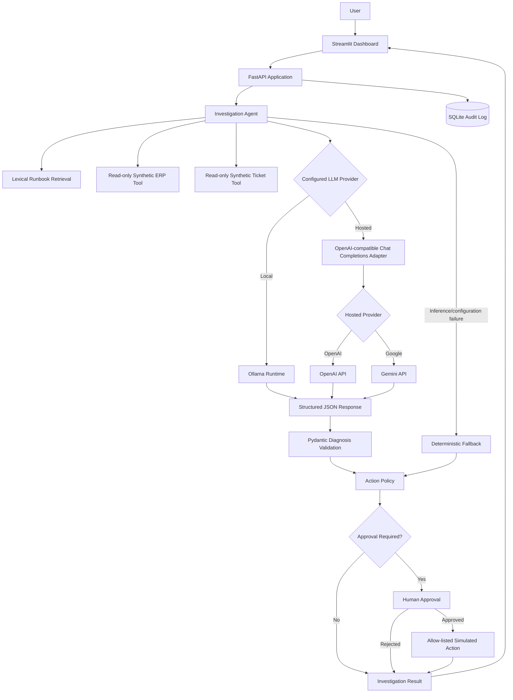

# OpsFlow AI

Evidence-grounded incident investigation with human-approved simulated actions.

Workflow: incident intake → runbook retrieval → read-only ERP/ticket tools → configured LLM structured diagnosis (Ollama, OpenAI API or Gemini API) → human approval → allow-listed simulated action → SQLite audit.

## Architecture

The diagram shows the current portfolio MVP architecture. ERP and ticket tools use synthetic data; corrective actions are simulated. Select one LLM provider through environment configuration: local Ollama, OpenAI API, or Gemini API. OpenAI and Gemini use the shared Chat Completions-compatible integration.



## Safety boundary

Synthetic portfolio data only. No real ERP, ticketing or production connection. The LLM cannot execute actions; API code enforces approval and an action allow-list.

## Local setup

Requirements: Python 3.11+ and [Ollama](https://ollama.com/download).

```bash
python -m venv .venv
source .venv/bin/activate        # Windows PowerShell: .venv\\Scripts\\Activate.ps1
pip install -e ".[dev]"
cp .env.example .env             # Windows PowerShell: Copy-Item .env.example .env
ollama pull llama3.2:3b
```

The default `.env.example` selects local Ollama. Ensure Ollama is running (the desktop app normally starts its local service; otherwise run `ollama serve`). In separate terminals, start the backend and frontend:

```bash
uvicorn app.main:app --reload
```

```bash
OPSFLOW_API_URL=http://127.0.0.1:8000 streamlit run frontend/dashboard.py
```

On Windows PowerShell, set the frontend API URL first with `$env:OPSFLOW_API_URL="http://127.0.0.1:8000"`, then run `streamlit run frontend/dashboard.py`. Open the Streamlit URL printed in the terminal. API docs: http://localhost:8000/docs. Run automated tests with `pytest -q`.

### Verify local Ollama inference

1. Confirm the model is installed with `ollama list`.
2. Confirm the Ollama service responds with `ollama run llama3.2:3b` and a short test prompt; exit with `/bye`.
3. Start the FastAPI backend and Streamlit frontend as above.
4. Submit a synthetic ERP incident through the dashboard.
5. Confirm the diagnosis displays `LLM used: True` rather than `Fallback`.
6. Retrieve the investigation audit using `GET /audit/{investigation_id}` and confirm an `llm_inference_succeeded` event with provider `ollama` and model `llama3.2:3b`.

Live model inference is an optional local smoke test, not part of GitHub Actions CI. Record the machine/OS, model tag, test date, result and any latency you actually measure; do not report unmeasured accuracy or performance.

## Optional hosted inference

The same backend can use a hosted Chat Completions-compatible API. Set `LLM_PROVIDER=openai_compatible`, `LLM_BASE_URL`, `LLM_MODEL` and `LLM_API_KEY` in the backend environment. The adapter is intended to connect to OpenAI API or Gemini API using the provider's compatible endpoint, model name and API key. Confirm the selected model supports Chat Completions and JSON response format. Store API keys only in secret environment settings; never commit them. If configuration or inference fails, OpsFlow uses its deterministic fallback.

For Render, `localhost` refers to the Render container, not your laptop. A locally installed Ollama service is therefore available to a locally running OpsFlow backend, not automatically to the hosted Render backend.

## Evaluation

See [docs/evaluation.md](docs/evaluation.md) for automated test coverage, safety rules, a reproducible scenario checklist and known evaluation gaps.

## Limitations

Active workflow state is in memory; retrieval is lexical rather than vector RAG; ERP/ticket data are synthetic; execution is simulated. Authentication, approver identity verification, tenant isolation, durable orchestration and production hardening are not implemented. This is a portfolio MVP, not production-ready software.
