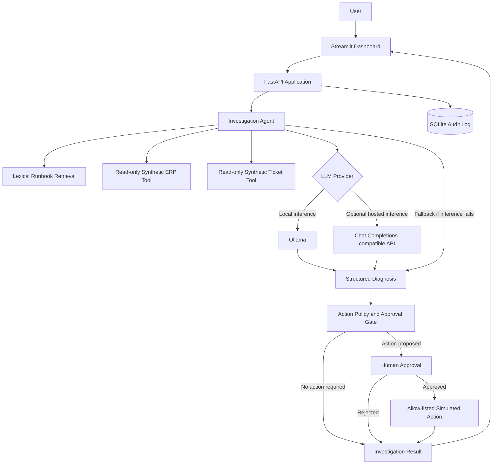

# OpsFlow AI

Evidence-grounded incident investigation with human-approved simulated actions.

Workflow: incident intake → runbook retrieval → read-only ERP/ticket tools → Ollama structured diagnosis → human approval → allow-listed simulated action → SQLite audit.

## Architecture

The diagram shows the current portfolio MVP architecture. ERP and ticket tools use synthetic data; corrective actions are simulated.



## Safety boundary
Synthetic portfolio data only. No real ERP, ticketing or production connection. The LLM cannot execute actions; API code enforces approval and an action allow-list.

## Setup
Python 3.11+. Inference supports local Ollama or a hosted Chat Completions-compatible API.
```powershell
python -m venv .venv
.\\.venv\\Scripts\\Activate.ps1
pip install -e ".[dev]"
Copy-Item .env.example .env
ollama pull llama3.2:3b
```
By default, OpsFlow uses local Ollama. For hosted inference, set `LLM_PROVIDER=openai_compatible`, `LLM_BASE_URL`, `LLM_MODEL` and `LLM_API_KEY` in the backend environment. Store the API key only in the hosting provider's secret environment settings; never commit it. The endpoint must support Chat Completions and JSON response format. If configuration or inference fails, OpsFlow uses its deterministic fallback. Start Ollama with `ollama serve` when using the local provider. In separate terminals run `uvicorn app.main:app --reload` and `streamlit run frontend/dashboard.py`. API docs: http://localhost:8000/docs. Tests: `pytest -q`.

## Limitations
Active workflow state is in memory; retrieval is lexical rather than vector RAG; ERP/ticket data are synthetic; execution is simulated. Authentication, approver identity verification, tenant isolation, durable orchestration and production hardening are not implemented. This is a portfolio MVP, not production-ready software.
