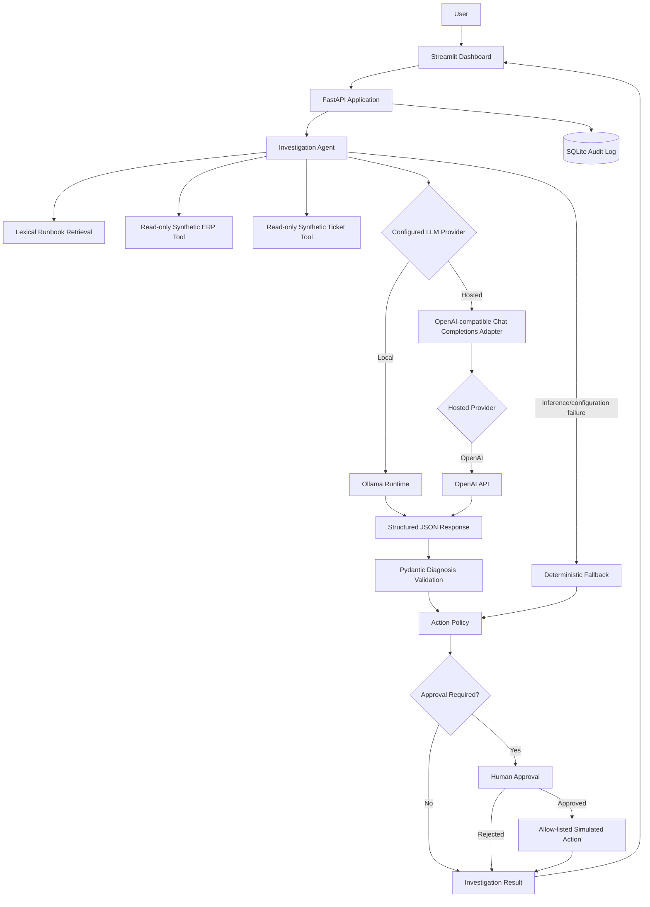

# OpsFlow AI

Evidence-grounded incident investigation with human-approved simulated actions.

Workflow: incident intake → runbook retrieval → read-only ERP/ticket tools → configured LLM structured diagnosis (local Ollama or a hosted Chat Completions-compatible API) → human approval → allow-listed simulated action → SQLite audit.

## Architecture

The diagram shows the current portfolio MVP architecture. ERP and ticket tools use synthetic data; corrective actions are simulated. Select one LLM provider through environment configuration: local Ollama or a hosted Chat Completions-compatible API. The hosted adapter sends a Chat Completions request and expects a JSON-object response; use a provider/model that supports this request format.



## Safety boundary

Synthetic portfolio data only. No real ERP, ticketing or production connection. The LLM cannot execute actions; API code enforces approval and an action allow-list.

## Local setup

Requirements: Python 3.11+ and [Ollama](https://ollama.com/download).

```bash
python -m venv .venv
source .venv/bin/activate        # Windows PowerShell: .venv\\Scripts\\Activate.ps1
pip install -e ".[dev]"
cp .env.example .env             # Windows PowerShell: Copy-Item .env.example .env
ollama pull llama3.2:3b
```

The default `.env.example` selects local Ollama. Ensure Ollama is running (the desktop app normally starts its local service; otherwise run `ollama serve`). In separate terminals, start the backend and frontend:

```bash
uvicorn app.main:app --reload
```

```bash
OPSFLOW_API_URL=http://127.0.0.1:8000 streamlit run frontend/dashboard.py
```

On Windows PowerShell, set the frontend API URL first with `$env:OPSFLOW_API_URL="http://127.0.0.1:8000"`, then run `streamlit run frontend/dashboard.py`. Open the Streamlit URL printed in the terminal. API docs: http://localhost:8000/docs. Run automated tests with `pytest -q`.

### Verify local Ollama inference

1. Confirm the model is installed with `ollama list`.
2. Confirm the Ollama service responds with `ollama run llama3.2:3b` and a short test prompt; exit with `/bye`.
3. Start the FastAPI backend and Streamlit frontend as above.
4. Submit a synthetic ERP incident through the dashboard.
5. Confirm the diagnosis displays `LLM used: True` rather than `Fallback`.
6. Retrieve the investigation audit using `GET /audit/{investigation_id}` and confirm an `llm_inference_succeeded` event with provider `ollama` and model `llama3.2:3b`.

Live model inference is an optional local smoke test, not part of GitHub Actions CI. Record the machine/OS, model tag, test date, result and any latency you actually measure; do not report unmeasured accuracy or performance.

### Troubleshooting local setup

**Uvicorn reports `[Errno 48] Address already in use` (macOS/Linux)**

This usually means another process is already listening on port 8000. Check which process owns the port:

```bash
lsof -nP -iTCP:8000 -sTCP:LISTEN
```

If it is the existing OpsFlow backend, use that instance; do not start a second server. If you need to restart it, stop it with `Ctrl+C` in the terminal where it is running. If that terminal is unavailable, inspect the PID and command first:

```bash
ps -p <PID> -o pid,ppid,command
```

Only stop the process after confirming it is the OpsFlow Uvicorn process. Then start the backend again with `uvicorn app.main:app --reload`. Do not terminate an unidentified process.

**Check the backend and Ollama independently**

```bash
curl -i http://127.0.0.1:8000/health
curl http://localhost:11434/api/generate \\
  -H "Content-Type: application/json" \\
  -d '{"model":"llama3.2:3b","prompt":"Return a short JSON response.","stream":false,"format":"json"}'
```

The health endpoint should return HTTP 200. The Ollama request should return JSON with a `response` field. These checks prove that the services respond independently; they do not prove that the OpsFlow investigation workflow succeeds.

**Streamlit reports HTTP 500 from `/investigate`**

1. Reproduce the request while watching the terminal running Uvicorn.
2. Copy the Python traceback printed at the time of the request. The final exception lines identify the backend failure; an HTTP 500 alone does not identify its cause.
3. Check the effective settings without printing secrets:

   ```bash
   python -c "from app.config import settings; print('Provider:', settings.llm_provider); print('Ollama URL:', settings.ollama_base_url); print('Ollama model:', settings.ollama_model); print('Hosted base URL configured:', bool(settings.compatible_base_url)); print('Hosted model configured:', bool(settings.compatible_model)); print('API key configured:', bool(settings.compatible_api_key)); print('Timeout:', settings.llm_timeout_seconds)"
   ```

4. Check whether a local `.env` file exists. It is optional when application defaults are suitable; if you create one, start from `.env.example`. Do not paste API keys or other secrets into issue reports.
5. Share the traceback and non-secret configuration values when requesting help. Do not treat a successful `/health` response as proof that `/investigate` is healthy.

## Hosted API-key inference (local backend)

Use this option when you want OpsFlow to call a hosted Chat Completions-compatible model instead of local Ollama. The backend currently calls `{LLM_BASE_URL}/chat/completions`, sends a Bearer API key when configured, requests `response_format: {"type":"json_object"}`, and reads `choices[0].message.content`. Select a provider endpoint and model that support this request format. For OpenAI, the base URL is `https://api.openai.com/v1`; use a model available to the API project that supports JSON mode. See the [Chat Completions API reference](https://developers.openai.com/api/reference/resources/chat/subresources/completions/methods/create) for the request format and [API authentication guidance](https://developers.openai.com/api/reference/overview) for secret handling.

1. Copy `.env.example` to `.env` if you have not already.
2. Change the provider and add the hosted endpoint, model identifier and API key to the local `.env` file:

   ```dotenv
   LLM_PROVIDER=openai_compatible
   LLM_BASE_URL=https://api.openai.com/v1
   LLM_MODEL=<model-supported-by-your-api-project>
   LLM_API_KEY=<your-api-key>
   LLM_TIMEOUT_SECONDS=60
   ```

3. Keep the key only in your local `.env`. Confirm `.env` is ignored by Git before proceeding; never paste a real key into source code, README, screenshots, terminal transcripts, issue reports or chat.
4. Restart the FastAPI process so it reloads environment settings.
5. Submit a synthetic incident and verify the dashboard indicates `LLM used: True`. Check the audit event for `llm_inference_succeeded` and provider `openai_compatible`. If inference fails, inspect the backend logs and `llm_diagnostic`; OpsFlow falls back to its deterministic diagnosis.

A ChatGPT subscription and API usage are separate. API access, quotas and billing depend on the API account/project. Do not assume a key has available quota; a valid key can still receive quota or rate-limit errors.

## Hosted deployment / production-app connection

The hosted Streamlit frontend must call a reachable backend URL, and the API key must remain on the backend. For the current portfolio deployment pattern (Streamlit frontend + Render FastAPI backend):

**Backend service (Render)**

1. Open the FastAPI backend service's Environment settings.
2. Add these environment variables. Use the actual backend model identifier selected for the API account:

   ```text
   LLM_PROVIDER=openai_compatible
   LLM_BASE_URL=https://api.openai.com/v1
   LLM_MODEL=<model-supported-by-your-api-project>
   LLM_API_KEY=<set-as-a-secret-environment-variable>
   LLM_TIMEOUT_SECONDS=60
   ```

3. Save the settings and redeploy/restart the backend service so the process receives them.
4. Check the backend health URL: `https://<your-backend-host>/health`. Then submit a synthetic incident through the hosted frontend and verify the LLM success audit event.

**Frontend service (Streamlit)**

Set the Streamlit app's `OPSFLOW_API_URL` environment variable to the reachable backend base URL, for example:

```text
OPSFLOW_API_URL=https://<your-backend-host>
```

Redeploy/restart the frontend after changing its environment. Do not put `LLM_API_KEY` in Streamlit frontend settings, browser code, query parameters or frontend requests. The browser should call Streamlit; Streamlit calls FastAPI; only FastAPI calls the model provider.

**Important deployment boundary:** This documents connecting the hosted OpsFlow demo to a hosted model API. It does not connect OpsFlow to a real production ERP or ticketing system. The ERP/ticket tools remain synthetic and corrective actions remain simulated. Before any real production integration, implement authentication and authorization, secret management, network controls, tenant isolation, durable state/audit, monitoring, approval identity verification, security review and operational testing. Do not send customer or company data to a third-party model unless the data owner and your organization's security/privacy policies explicitly permit it.

For Render, `localhost` refers to the Render container, not your laptop. A locally installed Ollama service is available to a locally running OpsFlow backend, not automatically to the hosted Render backend.
## Evaluation

See [docs/evaluation.md](docs/evaluation.md) for automated test coverage, safety rules, a reproducible scenario checklist and known evaluation gaps.

## Limitations

Active workflow state is in memory; retrieval is lexical rather than vector RAG; ERP/ticket data are synthetic; execution is simulated. Authentication, approver identity verification, tenant isolation, durable orchestration and production hardening are not implemented. This is a portfolio MVP, not production-ready software.
